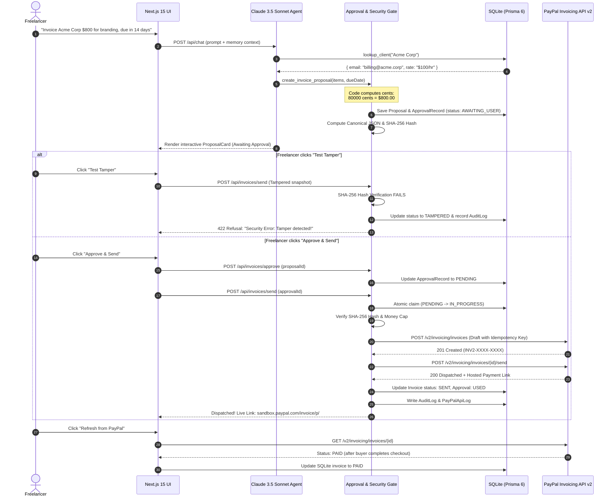

# InvoicePilot ✈️

> **The Human-Governed AI Billing Agent for Freelancers**  
> *Built for the PayPal AI Hackathon 2026*

[](https://nextjs.org/)
[](https://www.typescriptlang.org/)
[](https://tailwindcss.com/)
[](https://www.prisma.io/)
[](https://developer.paypal.com/docs/api/invoicing/v2/)
[](https://anthropic.com/)
[](LICENSE)

---

## 📌 Executive Summary

Freelancers spend an average of **5.8 hours per week** chasing unpaid invoices, calculating manual prorated rates, and drafting awkward payment follow-ups. While conversational AI agents can easily parse plain English instructions like *"Invoice Acme Corp $800 for logo design, due in 14 days"*, giving an autonomous AI model direct money-movement privileges is dangerous, prone to hallucinations, and commercially reckless.

**InvoicePilot** bridges this gap by combining the speed of **Anthropic Claude 3.5 Sonnet** with the financial reliability of **PayPal Invoicing API v2 (Sandbox)** and a strict **Zero-Privilege Human-in-the-Loop Governance Gate**:
1. **The AI agent has ZERO write access to money or dispatching**: Claude can only search client memory and structure invoice proposals.
2. **Deterministic Code-Computed Math**: All financial sums, tax calculations, and overdue evaluations are executed strictly in integer minor units (cents) in backend code—never hallucinated by the LLM.
3. **Cryptographic SHA-256 Tamper Proofing**: When a proposal is generated, its sorted canonical payload snapshot is cryptographically hashed. The backend refuses to dispatch any invoice if a single byte has been modified after review.
4. **Live Hosted PayPal Payments**: Dispatches live invoices directly to PayPal Sandbox, generating real buyer payment portals (`https://www.sandbox.paypal.com/invoice/p/#...`) where clients can pay via PayPal, debit/credit cards, or sandbox balances.
5. **Data Honesty Badges**: Clear visual differentiation between **🟢 PayPal Sandbox (Live)** synchronized records and **🟣 Local Demo Records** for realistic portfolio demonstration.

---

## 🏗️ Architecture & Security Governance Flow

InvoicePilot enforces a strict four-state approval state machine:  
`AWAITING_USER` $\rightarrow$ `PENDING` $\rightarrow$ `IN_PROGRESS` $\rightarrow$ `USED` (or `TAMPERED` / `FAILED` / `REVOKED`)



---

## ✨ Core Features

| Feature | Description |
| :--- | :--- |
| **Natural Language Billing** | Create complete multi-item invoices from informal conversational prompts (e.g., *"Bill TechFlow $1,200 for 12 hours of React development"*). |
| **Zero-Privilege Security** | Anthropic tools are strictly read/draft only (`lookup_client`, `create_invoice_proposal`, `list_invoices`, `get_invoice_status`, `draft_reminder`). AI cannot send invoices or touch funds. |
| **Cryptographic Integrity Gate** | Canonical key sorting and SHA-256 hash snapshot verification prevent tampering between user review and PayPal transmission. |
| **Idempotent REST Dispatch** | Every PayPal draft creation and send operation carries an immutable `PayPal-Request-Id` UUID, preventing duplicate invoice generation even under network retries. |
| **Live PayPal Sandbox Integration** | Creates real PayPal Invoicing v2 draft objects, sends them, and retrieves authentic hosted buyer checkout links (`/invoice/p/#...`). |
| **Deterministic Financials** | All numbers calculated in integer cents; overdue status computed deterministically via date math against `Asia/Kolkata` (IST) without timezone drift. |
| **Polite & Firm Reminders** | Drafts customized follow-ups for unpaid invoices with tone selection, subject generation, and PayPal 24-hour frequency rate limiting (max 2 reminders/24h). |
| **Full Governance Audit Trail** | Transparent slide-over drawer with real-time logs of all human approval decisions, tamper blocks, and raw PayPal REST request/response metadata. |
| **Incomplete Send Recovery** | If a network glitch occurs between draft creation and dispatch, the UI displays a "Retry Send" button that resumes the transaction without creating a duplicate. |

---

## 🚀 Quickstart Guide

### Prerequisites
- **Node.js**: `v18.0.0` or higher (verified on Node `v22.14.0`)
- **PayPal Developer Account**: Sandbox account at [developer.paypal.com](https://developer.paypal.com/)
- **Anthropic API Key**: From [console.anthropic.com](https://console.anthropic.com/)

### 1. Clone & Install
```bash
git clone https://github.com/your-username/InvoicePilot.git
cd InvoicePilot
npm install
```

### 2. Configure Environment Variables
Copy `.env.example` to `.env`:
```bash
cp .env.example .env
```
Update `.env` with your sandbox credentials:
```env
# PayPal Sandbox Configuration (SANDBOX ONLY)
PAYPAL_ENV=sandbox
PAYPAL_BASE_URL=https://api-m.sandbox.paypal.com
PAYPAL_CLIENT_ID=your_sandbox_client_id_here
PAYPAL_CLIENT_SECRET=your_sandbox_client_secret_here
PAYPAL_MERCHANT_EMAIL=your_sandbox_business_email@business.example.com
PAYPAL_BUYER_EMAIL=your_sandbox_personal_email@personal.example.com

# Anthropic Claude Configuration
ANTHROPIC_API_KEY=your_anthropic_api_key_here
ANTHROPIC_MODEL=claude-3-5-sonnet-20241022

# Security & Money Guardrails
MAX_INVOICE_AMOUNT_CAP=1000000 # Max $10,000.00 in cents
DATABASE_URL="file:./dev.db"
```

> [!IMPORTANT]
> **PayPal Sandbox Account Configuration**:
> 1. Ensure your Sandbox Business account is set to **United States (US)** in the PayPal Developer Dashboard.
> 2. In your Developer App settings under **Features**, ensure the **Invoicing** capability checkbox is enabled and saved.

### 3. Initialize & Seed Database
Run the Prisma migration and seed script to populate demo clients and baseline invoices:
```bash
npx prisma migrate dev --name init
node prisma/seed.mjs
```

### 4. Run Development Server
```bash
npm run dev
```
Open **[http://localhost:3000](http://localhost:3000)** in your browser.

---

## 🧪 Testing Walkthrough (For Hackathon Judges)

### Flow 1: Natural Language Invoice Creation & Human Approval
1. In the chat interface, enter:
   ```text
   Invoice Acme Corp $800 for logo design and brand guide, due in 14 days
   ```
2. The AI agent:
   - Queries client memory for Acme Corp (`billing@acme.corp`).
   - Computes integer cents: $800.00 = 80,000 cents.
   - Computes due date (+14 days).
   - Generates a canonical snapshot and locks an approval record in `AWAITING_USER` state.
3. Observe the interactive **ProposalCard** appearing in the chat with item details, total amount, and due date.
4. Click **Approve & Send Invoice**:
   - Backend transitions approval to `PENDING`, claims it atomically to `IN_PROGRESS`, verifies the SHA-256 hash, and calls PayPal Invoicing API v2.
   - The card displays the real PayPal live invoice ID (e.g. `INV2-XXXX-XXXX`) and an authentic **Pay via PayPal** link.
5. In the left-hand panel, notice the new invoice appears with the **🟢 PayPal Sandbox (Live)** badge and status **SENT**.

---

### Flow 2: Live Buyer Payment via PayPal Sandbox
1. Click the green **Pay via PayPal** button on any sent invoice.
2. The hosted PayPal checkout portal opens (`https://www.sandbox.paypal.com/invoice/p/#...`).
3. Log in with your Sandbox Personal Buyer credentials (`sb-t71bk53750800@personal.example.com`).
4. Click **Complete Purchase** to pay with sandbox test funds.
5. Return to the InvoicePilot dashboard and click **Refresh from PayPal** in the top navigation.
6. The app queries the PayPal Invoicing API v2 GET endpoint and immediately updates the status to **PAID** with updated totals in the metric cards!

---

### Flow 3: Security Gate & Tamper Refusal Test (The AI Safety Proof)
1. Ask the copilot to draft any new invoice proposal.
2. Instead of clicking Approve, click the subtle **Test Tamper** button at the bottom left of the proposal card.
3. The client sends a tampered snapshot with an altered amount ($1,500 instead of $1,000).
4. The server's cryptographic verification detects that `computedHash !== storedHash`.
5. The request is immediately rejected with HTTP 422:
   ```
   Security Error: Tamper detected! Approval snapshot does not match cryptographic hash.
   ```
6. The approval record in the database is locked as `TAMPERED`, and a `TAMPER_ATTEMPT` event is permanently recorded in the immutable audit log.
7. Click **Audit Trail** in the navbar to inspect the blocked tamper attempt and verified hash values.

---

### Flow 4: Overdue Tracking & Polite Payment Reminder
1. In the search/filter tabs on the left, click **Overdue**.
2. Notice the overdue invoice flagged using strict IST date math.
3. Click the **Remind** button next to the overdue invoice.
4. The copilot drafts a polite, professional payment reminder email with customized subject line and payment link.
5. Review the reminder draft card and click **Approve & Send Reminder** to dispatch the notification via PayPal's remind endpoint.

---

## 🛠️ Automated Test Suites

InvoicePilot includes comprehensive automated test suites covering all layers:

```bash
# Test 1: Approval Engine, SHA-256 Canonical Hashing, & State Machine (20 tests)
node scripts/test-phase2-approval.mjs

# Test 2: Anthropic Agent Tools & Deterministic Overdue Calculations (27 tests)
node scripts/test-phase3-agent.mjs

# Test 3: Comprehensive End-to-End Live PayPal REST Sandbox Verification (13 tests)
node scripts/test-phase4-e2e.mjs

# Test 4: Production Build Compilation & Static Page Validation
npm run build
```

---

## 📂 Project Structure

```text
InvoicePilot/
├── prisma/
│   ├── migrations/          # SQLite schema migration history
│   ├── schema.prisma        # Database schema (User, Invoices, Approvals, AuditLogs)
│   └── seed.mjs             # Realistic demo seeding (Acme Corp, TechFlow, Demo Invoices)
├── scripts/
│   ├── verify-paypal-flow.mjs   # Standalone PayPal v2 Sandbox flow verifier
│   ├── test-phase2-approval.mjs # Approval engine and security gate tests
│   ├── test-phase3-agent.mjs    # Anthropic Claude agent tool verification
│   └── test-phase4-e2e.mjs      # Full end-to-end integration test
├── src/
│   ├── app/
│   │   ├── api/
│   │   │   ├── audit/           # Audit trail & PayPal REST API logs
│   │   │   ├── chat/            # Claude 3.5 Sonnet conversational agent
│   │   │   ├── invoices/        # Invoice listing & deterministic metrics
│   │   │   ├── invoices/approve # Human proposal approval endpoint
│   │   │   ├── invoices/retry   # In-progress draft dispatch resumption
│   │   │   ├── invoices/send    # Cryptographic verification & PayPal dispatch
│   │   │   ├── invoices/sync    # PayPal live status polling & synchronization
│   │   │   └── reminders/send   # Reminder approval & PayPal dispatch
│   │   ├── globals.css          # Tailwind CSS styling
│   │   ├── layout.tsx           # Responsive root layout
│   │   └── page.tsx             # Main dashboard (Invoices + AI Copilot)
│   ├── components/
│   │   ├── AuditModal.tsx       # Slide-over governance & REST log drawer
│   │   ├── ChatInterface.tsx    # Conversational agent chat with embedded cards
│   │   ├── InvoiceList.tsx      # Receivables table with live status badges
│   │   ├── Navbar.tsx           # Brand header, sandbox indicator & sync trigger
│   │   ├── ProposalCard.tsx     # Interactive proposal preview & tamper test
│   │   ├── ReminderCard.tsx     # Payment reminder draft preview
│   │   └── StatsCards.tsx       # Code-computed financial summary cards
│   └── lib/
│       ├── agent/
│       │   ├── runner.ts        # Anthropic Claude tool-governed agent loop
│       │   └── tools.ts         # Strictly read-only & draft agent tools
│       ├── approval.ts          # State machine, canonical JSON & SHA-256 gate
│       ├── db.ts                # Prisma singleton instance
│       ├── logger.ts            # Sanitizing logger with token/email masking
│       ├── paypal.ts            # PayPal Invoicing API v2 client & token cache
│       └── types.ts             # Zod schemas, minor unit math & IST date math
├── .env.example                 # Documented environment variable template
├── .gitignore                   # Strict protection: no secrets, no DBs, no logs
├── LICENSE                      # MIT Open Source License
├── package.json                 # Project dependencies & scripts
└── tsconfig.json                # TypeScript configuration
```

---

## 🔒 Security & Compliance Rationale

1. **Zero Money-Movement Privilege**: Autonomous LLMs must never be granted API credentials that can initiate financial transactions or change amounts without explicit human verification.
2. **Canonical JSON Serialization**: Different runtimes serialize JSON object keys in different orders. By sorting object keys recursively, InvoicePilot guarantees that cryptographic hashes are 100% deterministic and reproducible across machines.
3. **No Direct Float Math**: Floating point arithmetic (e.g. `0.1 + 0.2 = 0.30000000000000004`) causes rounding errors that can corrupt financial balances. All internal calculations are strictly performed in integer minor units (cents).
4. **Credential Protection**: API credentials and access tokens are strictly confined to server-side execution. The custom logger actively masks sensitive tokens and headers before any log output.

---

## 📄 License

This project is licensed under the **MIT License** — see the [LICENSE](LICENSE) file for details. Built with ❤️ for the PayPal AI Hackathon 2026.
